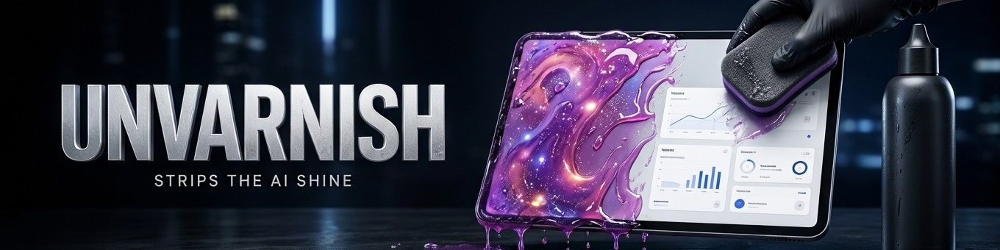
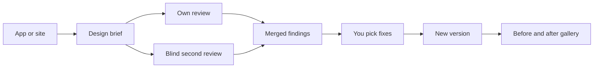

<p align="center"></p>

# Unvarnish

**Strips the AI shine.** A Claude Code skill that reviews an existing app or website like a seasoned, opinionated UX designer and takes off the generic AI polish.

## What it does
- Writes a short design brief for your product first, then judges everything against it.
- Reviews in three phases, from quick wins to UX laws. The rules are strong opinions, not hard law.
- Gets a second opinion from a low-context subagent, so its own bias doesn't run the review.
- You choose which fixes to apply. It writes a new version and never overwrites the original.
- Shows a before/after gallery with ratings, comments and copyable JSON.

## The three phases
| Phase | Covers | Examples |
|---|---|---|
| **1 · Obvious** | Mechanical fixes, low taste | Kill purple gradients, one accent color, a spacing scale, real icons, labels not placeholders, empty and error states, tap targets |
| **2 · Taste and behavior** | Look and feel that need judgment | Fewer cards, a font that isn't Inter, OKLCH palettes, layered shadows, undo toasts, optimistic updates, view transitions |
| **3 · Laws** | Layout, flow and priorities | Hick's, Fitts's and Jakob's laws, proximity, Von Restorff, Doherty threshold, peak-end rule, Tesler's law |

The full rule list is in [`rules.md`](rules.md).

## How it works


## Install
`SKILL.md` follows the open [Agent Skills](https://agentskills.io/specification) format. Keep `rules.md` next to it.

**Claude Code:**
```bash
git clone https://github.com/JR91387/unvarnish-ai-ux-review-skill ~/.claude/skills/unvarnish
# optional, for the before/after gallery:
git clone https://github.com/JR91387/lookbook-ai-ux-gallery-skill ~/.claude/skills/lookbook
```

**Other agents that support Agent Skills:** clone both into that agent's skills folder, side by side.

Without the lookbook skill, Unvarnish builds a plain two-column before/after page with the same rating and copy controls.

## Usage
```
/unvarnish https://example.com
/unvarnish ./src
```
Anything works as a target: a URL, a source folder, a single HTML file or screenshots.

## Files
| File | What it is |
|---|---|
| `SKILL.md` | The skill: brief, two-pass audit, approval, fix, verify, gallery |
| `rules.md` | The rules, in three phases |

## Credits
Companion gallery: [lookbook-ai-ux-gallery-skill](https://github.com/JR91387/lookbook-ai-ux-gallery-skill). Optional companion for deeper design passes: [pbakaus/impeccable](https://github.com/pbakaus/impeccable). Built with AI assistance (Claude); the banner and social images were made with an AI image model.

## License
[MIT](LICENSE)

---

Built by **Jerry Reinitz** · [github.com/JR91387](https://github.com/JR91387) · [jerryreinitz.com](https://jerryreinitz.com)<br>
Midwest AI and software engineer who builds for people, not for checkboxes.

---

**More from Reinitz Industries:** [Lookbook](https://github.com/JR91387/lookbook-ai-ux-gallery-skill) · [Word Vomit Jargon](https://github.com/JR91387/vomit-jargon-ai-skill) · [/bruh](https://github.com/JR91387/claude-skill-bruh) · [/bully](https://github.com/JR91387/claude-skill-bully) · [Job-o-Matic](https://github.com/JR91387/jobomatic-reusme-skills-database) · [Preen](https://github.com/JR91387/Preen-AI-email-sorting) · [Calendar Forge](https://github.com/JR91387/calendar-forge-ics)
